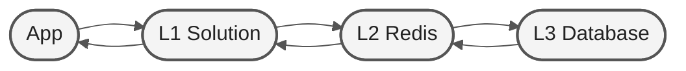

<h1 align="center">Mitigating Redis Exhaustion</h1>

<h3 align="center">Case Backend Engineer, check-in-at-ticket</h3>

  

## 📝 Background

Our global accommodation booking platform fetches live currency exchange rates (e.g., IDR to USD) from our central Redis to display localized pricing. During a major global flash sale last month, traffic spiked to 50,000 requests per second. Because every single user request triggered a separate network call to Redis, we suffered severe connection pool exhaustion and the Redis CPU maxed out. This caused Redis to become completely unresponsive, taking our entire booking system down for 45 minutes.

- **Industry Context:** Online Travel Agents (OTAs) must display accurate pricing and financial data in real time. However, relying purely on remote network calls for highly repetitive data creates a fragile bottleneck.
- **Baseline Data:** The system currently makes 1 Redis network call per user request. During peak load, 99.9% of these calls are asking for the exact same currency-pair data that hasn't changed.
- **Constraints:** We cannot simply "buy a larger Redis" because it is cost-prohibitive and doesn't solve the underlying architectural inefficiency. The engineering team has to design an application-layer fix to shield Redis before the next major holiday campaign.

## 🎯 Objectives

- **Primary Deliverable:** A strategic system design proposal for an L1 (Local In-Memory) Cache sitting directly inside our backend servers to shield the remote Redis.

- **Success Metrics:**
  - Reduce outbound Redis network connections and calls by at least 95% during high-traffic spikes.
  - Ensure currency rates served to users are never older than a few seconds, preventing financial loss from stale data.
  - Identify the risks of high concurrency on local server memory.

## Architecture Diagram

